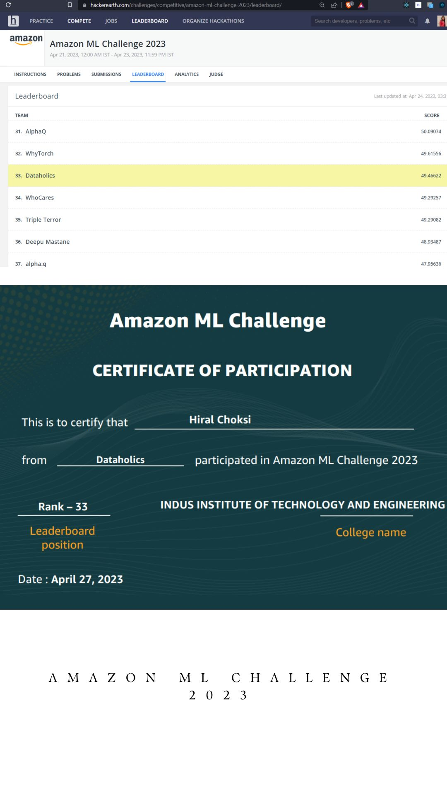

# Product Length Prediction — Amazon ML Challenge 2023

**Team Dataholics · Rank 33 · Leaderboard score: 49.46622**

A competitive machine learning project focused on predicting a product's physical length. This repository preserves Hiral Choksi's exploratory notebook and a record of the team's competition result.

## Competition result

| Item | Result |
| --- | --- |
| Competition | Amazon ML Challenge 2023 |
| Team | Dataholics |
| Leaderboard position | **33** |
| Leaderboard score | **49.46622** |
| Institution | Indus Institute of Technology and Engineering |

*Original leaderboard and certificate supplied by Hiral Choksi. The leaderboard confirms the team's rank and score. Hiral's announcement describes a competition with approximately 26,000 participants; that figure refers to participants, not a verified count of ranked teams.*

**Score interpretation:** 49.46622 is the leaderboard's competition score, not classification accuracy. The included notebook calculates a score as `max(0, 100 × (1 − MAPE))`. Its local baseline evaluation is separate from the team's leaderboard result.

## The prediction task

Estimate `PRODUCT_LENGTH` from product information. This is a **regression** task, rather than product-demand forecasting.

The saved notebook displays **2,249,698 training rows**. Available source fields include product titles, bullet points and descriptions; the included baseline selects `PRODUCT_ID` and `PRODUCT_TYPE_ID` as predictors.

## Team

- **Hiral Choksi**
- [Tosha Patel](https://www.linkedin.com/in/tosha24/)
- [Aniruddh Nair](https://www.linkedin.com/in/aniruddhnair/)
- [Yash Dhuliya](https://www.linkedin.com/in/yash-dhuliya-37667920b/)

The rank is a **team achievement**. Hiral's competition announcement describes experimentation with XGBoost, Random Forest and Logistic Regression as part of the team's broader work. The public notebook contains a **DecisionTreeRegressor baseline**; it does not document or reproduce the final ensemble submission.

## What the public notebook demonstrates

1. Load the competition training data using pandas.
2. Select product identifiers, product type and target length.
3. Remove missing rows, inspect duplicates and visualize length by product type.
4. Filter training rows to `PRODUCT_LENGTH <= 900`.
5. Create an 80/20 train/test split with `random_state=100`.
6. Train a decision-tree regressor and calculate MAPE.
7. Refit on the filtered training data, predict competition test rows and export a submission CSV.

[Explore the original notebook](PRODUCT_LENGTH_AMAZON_CHALLENGE.ipynb)

## Results and limitations

- **Team result:** rank 33 and leaderboard score 49.46622, documented in the image above.
- **Saved local baseline:** MAPE **1.0238015346479998** (approximately 102.38%), which yields **0** under the notebook's clipped score formula. This baseline should not be presented as the model that earned the team's leaderboard score.
- The notebook filters out lengths above 900 before splitting, so local evaluation covers a restricted target range.
- Product identifiers are used directly as numeric features; their predictive value and generalization warrant further evaluation.
- The public notebook does not implement the one-hot encoding, scaling, cross-validation or grid search previously described in this README.
- Original training and test datasets, exact dependency versions and the final team pipeline are not included. Saved outputs have not been independently reproduced.

## Repository contents

| File | Purpose |
| --- | --- |
| [PRODUCT_LENGTH_AMAZON_CHALLENGE.ipynb](PRODUCT_LENGTH_AMAZON_CHALLENGE.ipynb) | Original Colab analysis, decision-tree baseline and submission-generation workflow |
| [sample_submission.csv](sample_submission.csv) | Existing sample submission file |
| [Leaderboard and certificate](assets/leaderboard-and-certificate.png) | Evidence of the team's competition result |

## Running the notebook

Open the notebook in Google Colab or Jupyter with Python, pandas, NumPy, seaborn and scikit-learn. Supply the original competition `train.csv` and `test.csv`, then update the notebook's Google Drive paths. The data is not bundled with this repository.

## Skills demonstrated

Python · pandas · Exploratory Data Analysis · Data Cleaning · Regression · Decision Trees · MAPE Evaluation · Submission Preparation · Collaborative Machine Learning
